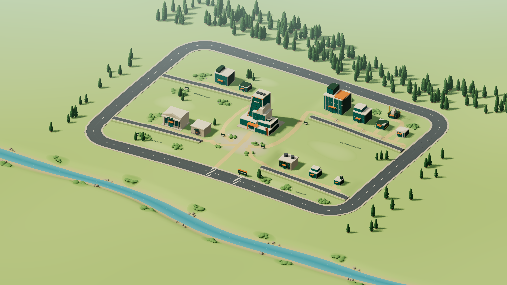

# AN PHIM World - 3D Creative Campus Diorama

An interactive, modular 3D campus diorama engineered with Three.js and WebGL.

[](https://anphanfilmmaker-dotcom.github.io/anphim-world-3d/)



## 🌐 Live Interactive Demo
- **URL:** [https://anphanfilmmaker-dotcom.github.io/anphim-world-3d/](https://anphanfilmmaker-dotcom.github.io/anphim-world-3d/)

## Overview

AN PHIM World showcases a stylized 3D diorama for creative operations, featuring:
- **Modular Architecture:** Procedural and custom building envelopes, glass shading, and entrance sockets.
- **Hierarchical Road Network:** Integrated arterial, internal street, and pedestrian pathway systems.
- **Layered Vegetation & Terrain:** Three-tier landscape (groundcover, shrubs, canopy) with instanced rendering.
- **Interactive Inspector:** Real-time raycasting selection, building metadata display, and layer toggles.
- **Cinematic Camera Choreography:** Free orbit controls alongside five calibrated architectural perspective presets.

## Technology Stack

- **Graphics Engine:** Three.js (WebGL)
- **Architecture:** Vanilla ES Modules with Import Maps
- **Asset Pipeline:** InstancedMesh optimization for high-density foliage and roads
- **3D Formats:** GLTF / GLB / OBJ

## Quick Start

You can run this project locally using any static web server:

### Option 1: Python
```bash
python -m http.server 8080
```
Then navigate to `http://localhost:8080` in your web browser.

### Option 2: Node.js / Vite
```bash
npm install
npm run dev
```

### Option 3: npx serve
```bash
npx serve .
```

## Camera Controls

- **Left Mouse Drag:** Orbit / Rotate view (view mode; in Edit Mode the left button is reserved for editing)
- **Middle Mouse Drag:** Orbit / Rotate view (also in Edit Mode)
- **Right Mouse Drag:** Pan scene
- **Scroll Wheel:** Zoom in / out toward the cursor
- **Arrow Keys:** Move across the campus (hold Shift to move faster)
- **Preset Buttons:** Animated move to Overview, Hero HQ, Topview, Front, and Side perspectives; dragging or scrolling interrupts it.

All camera motion goes through `camera-director.js` (`director.flyTo(...)`), not direct `camera.position` writes.
